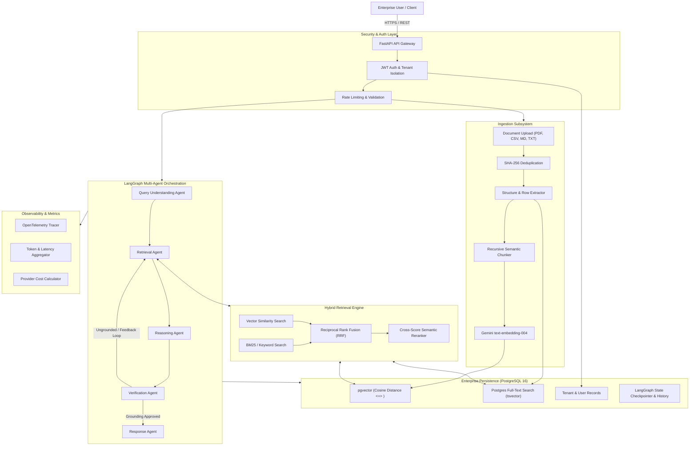

# NexusAI System Architecture

NexusAI is an enterprise-grade multi-agent Retrieval-Augmented Generation (RAG) platform. It transforms disparate enterprise knowledge into an auditable intelligence system through multi-agent orchestration, pgvector hybrid search, and automated grounding verification.

---

## 1. High-Level Architecture Diagram

---

## 2. Key Architectural Modules

### A. Modular Ingestion Pipeline
- **Extractors**: Preserves document structure. For tabular files (`.csv`), column names and row contexts are preserved rather than flattened into prose.
- **Chunker**: Recursive character chunker with configurable chunk size and overlap, maintaining page numbers and row offsets.
- **Deduplication**: Content hashing (SHA-256) per tenant prevents redundant vector indexing and costs.

### B. Hybrid Retrieval Engine
- **Vector Search**: Computes cosine distance (`<=>`) using PostgreSQL `pgvector`.
- **Keyword Search**: Uses PostgreSQL `to_tsvector` and `websearch_to_tsquery` with rank weighting.
- **Fusion**: Reciprocal Rank Fusion (RRF) blends scores without requiring cross-calibration of arbitrary distance units.
- **Reranker**: Evaluates top candidates for query-specific relevance.

### C. Multi-Agent Orchestration
- Coordinated via a LangGraph state machine with cyclic conditional edges.
- Prevents hallucinated claims by passing all candidate answers through an automated Verification Agent.

### D. Observability & Telemetry
- Every node in the LangGraph graph captures its start time, execution duration, token consumption, and status.
- Provider-reported usage metadata is recorded in PostgreSQL `request_metrics` and `agent_traces` tables.
