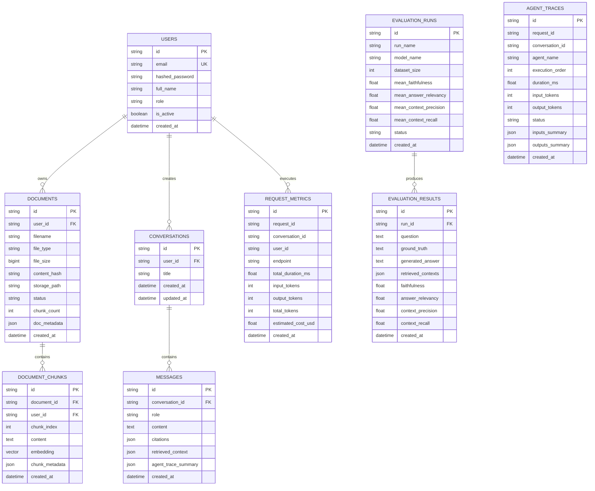

# Database Design & Schema Specification

NexusAI uses PostgreSQL 16 with the `pgvector` extension. A cross-platform abstraction (`SafeVector`) is provided for development and test execution.

---

## 1. Entity-Relationship Diagram

---

## 2. Multi-Tenant Isolation
Every query to `documents`, `document_chunks`, and `conversations` enforces tenant boundary isolation by joining or filtering on `user_id = :current_user_id`. Users cannot view or query documents belonging to another user.

## 3. Vector & Full-Text Search Indices
- **pgvector Index**: IVFFlat or HNSW cosine index on `document_chunks.embedding` using cosine distance `<=>`.
- **Full-Text Index**: GIN index on `to_tsvector('english', content)` for sub-millisecond keyword matching.
- **Content Hash Index**: Compound index on `(user_id, content_hash)` prevents duplicate file uploads.
